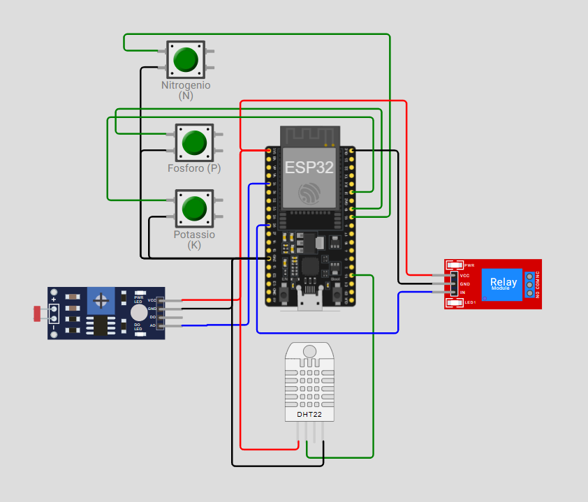
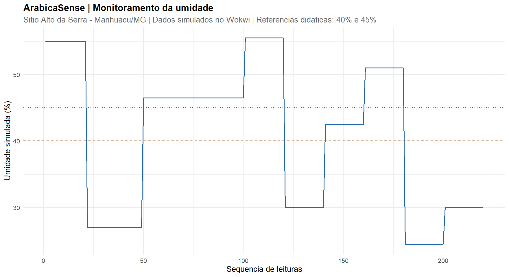
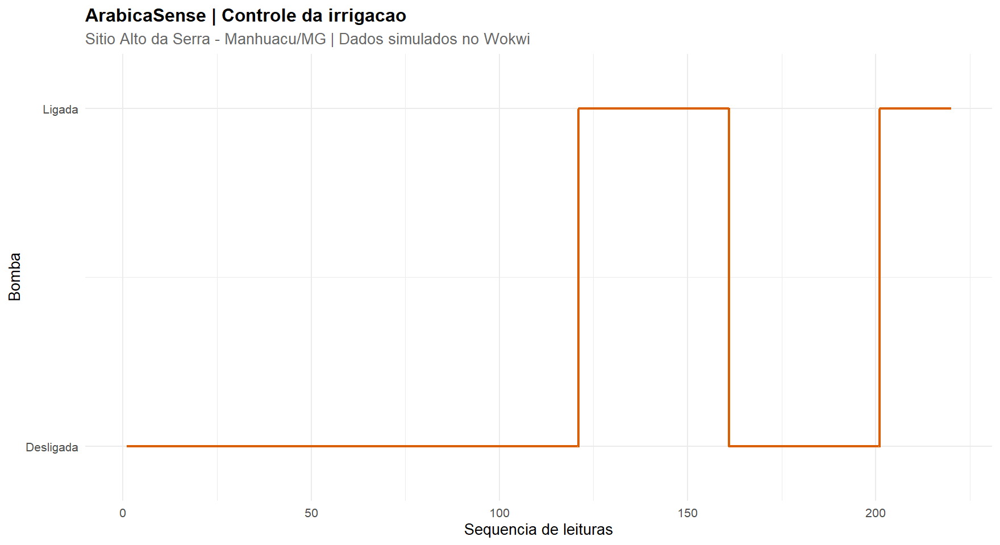
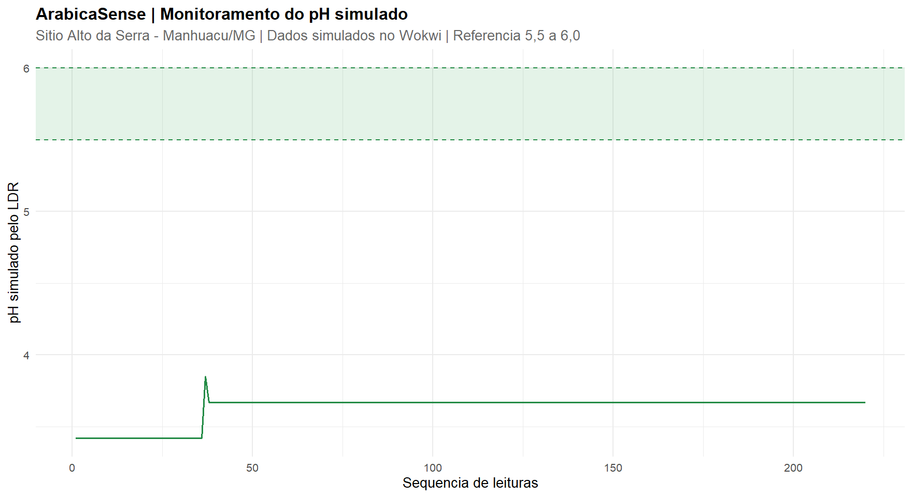
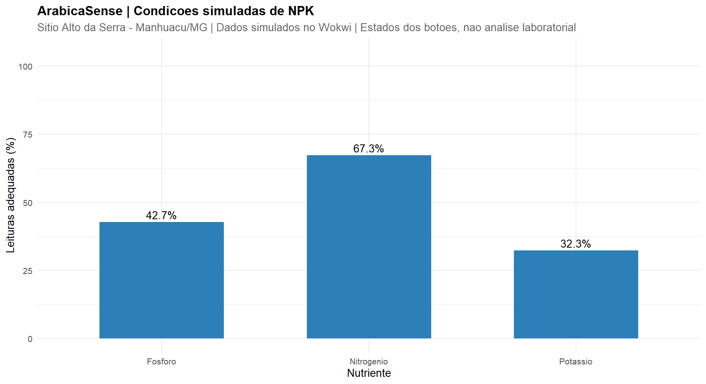
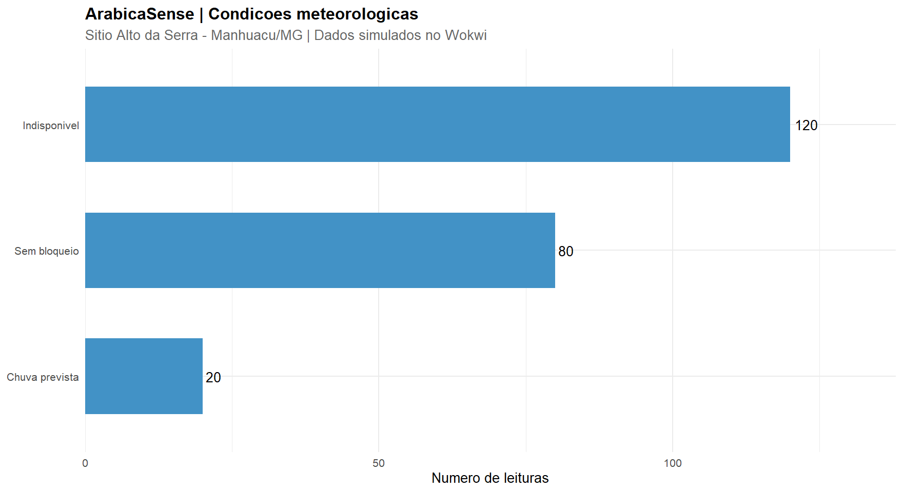
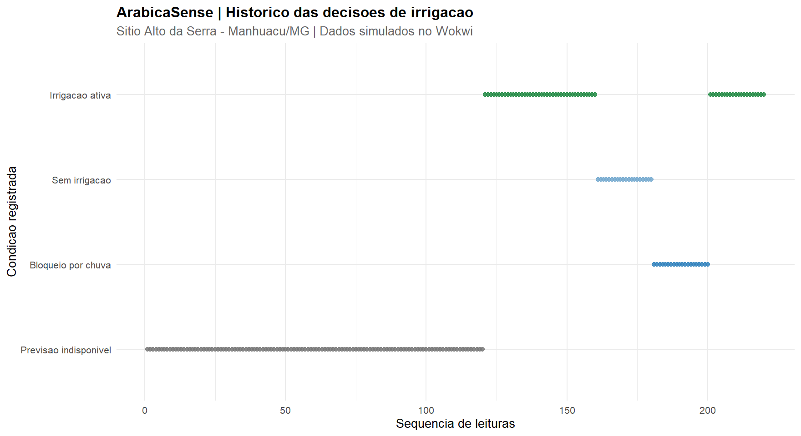

# ArabicaSense
## Monitoramento Inteligente e Gestão da Irrigação do Café Arábica

**FarmTech Solutions | FIAP — Fase 2**

**Estudo de caso:** Sítio Alto da Serra — Agricultura Familiar, Manhuaçu/MG

---

## 1. Apresentação

O **ArabicaSense** é um protótipo para monitoramento agrícola e gerenciamento inteligente da irrigação, desenvolvido para atender a Fase 2 do projeto FarmTech Solutions, da FIAP.

A proposta é investigar como tecnologias acessíveis, como microcontroladores, sensores, programação e análise de dados, podem apoiar pequenos produtores rurais nas decisões relacionadas ao cultivo do café arábica.
O sistema combina a simulação de parâmetros do solo com informações meteorológicas e regras automáticas para inicío da irrigação.

Utilizamos no projeto:


    - ESP32 
    - Wokwi 
    - C/C++ 
    - Python 
    - Integração com API Open-Meteo 
    - Análise Estatística em R.

## 2. Objetivos

### Objetivo geral

Desenvolver um protótipo de monitoramento agrícola e controle automatizado da irrigação para o café arábica, com foco na acessibilidade tecnológica para propriedades de agricultura familiar.

### Objetivos específicos

- Simular o monitoramento de nutrientes NPK.
- Representar o pH e a umidade do solo com os componentes estabelecidos na atividade.
- Implementar o acionamento automático de um relé utilizando o ESP32.
- Consultar previsões meteorológicas através do uso de API pública.
- Integrar as decisões meteorológicas ao controle de irrigação.
- Registrar um histórico das leituras e decisões do sistema.
- Aplicar métodos estatísticos utilizando R.
- Apresentar resultados por meio de gráficos e indicadores.

## 3. Contextualização da propriedade

O estudo de caso utiliza como referência o Sítio Alto da Serra, localizado em Manhuaçu, Minas Gerais.

| Característica | Informação |
|---|---|
| Propriedade | Sítio Alto da Serra |
| Município | Manhuaçu/MG |
| Área total informada | Aproximadamente 11 hectares |
| Cultura estudada | Café arábica |
| Público-alvo | Pequenos produtores e agricultura familiar |
| Tipo de implementação | Simulação acadêmica |

A localização da sede foi utilizada para parametrizar a consulta meteorológica, sem pressupor que toda a área informada esteja efetivamente cultivada com café.


## 4. Tecnologias utilizadas

| Tecnologia | Aplicação |
|---|---|
| ESP32 | Processamento e controle dos componentes |
| C/C++ e Arduino | Firmware do microcontrolador |
| PlatformIO | Compilação e gerenciamento do projeto |
| Wokwi | Simulação do circuito eletrônico |
| Python | Integração meteorológica e coleta de dados |
| Open-Meteo | API de fornecimento para previsão meteorológica |
| RFC2217 | Comunicação serial com o ESP32 virtual |
| R | Estatísticas e gráficos |
| VS Code | Desenvolvimento e execução |
| GitHub | Versionamento e disponibilização do projeto |

## 5. Arquitetura e componentes

O circuito é composto pelos seguintes elementos:

| Componente | GPIO | Função |
|---|---|---|
| Botão N | 18 | Simulação do estado do nitrogênio |
| Botão P | 19 | Simulação do estado do fósforo |
| Botão K | 21 | Simulação do estado do potássio |
| LDR | 34 | Representação analógica do pH |
| DHT22 | 15 | Representação da umidade do solo |
| Relé | 26 | Simulação do acionamento da bomba |

### Limitações dos sensores

Os botões não medem concentrações reais de nutrientes. Seus estados somente selecionam valores previamente definidos dentro do programa.

O LDR é um sensor de luminosidade, utilizado didaticamente para representar o pH. A conversão da leitura analógica para a escala de 0 a 14 não constitui uma calibração química real.

O DHT22 mede temperatura e umidade relativa do ar. Nesta atividade, a umidade informada é utilizada como substituta didática da umidade do solo.


### Imagem do circuito




## 6. Parâmetros agronômicos de referência

Para contextualizar a simulação do café arábica, foram adotados os seguintes valores ilustrativos:

| Indicador | Condição adequada simulada | Condição deficiente simulada |
|---|---|---|
| Nitrogênio foliar | 29 g/kg | 20 g/kg |
| Fósforo no solo | 18 mg/dm³ | 8 mg/dm³ |
| Potássio no solo | 110 mg/dm³ | 35 mg/dm³ |
| pH | Faixa-alvo de 5,5 a 6,0 | Fora da faixa-alvo |

As referências nutricionais dependem do estágio da cultura, das características do solo e dos métodos de análise. Os valores adotados não substituem uma recomendação de adubação.

Os alertas nutricionais são tratados separadamente das decisões de irrigação.

## 7. Controle automatizado da irrigação

O ESP32 monitora a umidade simulada e aplica regras de acionamento com margem de tolerância.

| Condição | Comportamento |
|---|---|
| Umidade inferior a 40% | Solicita irrigação |
| Umidade entre 40% e 45% | Preserva o estado anterior |
| Umidade superior a 45% | Desliga a irrigação |
| Chuva significativa prevista | Bloqueia a irrigação |
| Previsão indisponível | Mantém a bomba desligada |
| Falha no sensor de umidade | Desliga a bomba por segurança |

Os limites de umidade são demonstrativos e não representam uma prescrição agronômica de irrigação.

A margem de tolerância é utilizada para evitar alternâncias frequentes do relé nas proximidades dos limites configurados.

## 8. Ir Além 1 — Integração meteorológica com Python

O sistema utiliza a API pública Open-Meteo para consultar a previsão meteorológica da propriedade. A consulta considera a precipitação prevista nas próximas 24 horas e a maior probabilidade de chuva.

Para a demonstração, foi adotada a seguinte regra:

- Precipitação acumulada prevista igual ou superior a 3 mm.
- Probabilidade horária máxima igual ou superior a 60%.

Quando ambas as condições são atendidas, o programa sinaliza um bloqueio climático de irrigação.

Esses limites são parâmetros experimentais e não representam recomendação agronômica.

### Integração com ESP32

O Python produz os comandos:

- `CHUVA_PREVISTA=0`: sem bloqueio climático.
- `CHUVA_PREVISTA=1`: bloqueio por chuva.
- `CHUVA_PREVISTA=INDEFINIDA`: informação indisponível.

A transmissão é realizada por comunicação serial RFC2217 com o ESP32 simulado no Wokwi.

O script `integrar_meteorologia.py` executa a consulta e transmite a decisão automaticamente em cada execução. Nessa versão, ainda não está disponível o disparo automático de novas consultas pelo ESP32.

## 9. Ir Além 2 — Análise estatística em R

As informações geradas pelo ESP32 são organizadas em um historico_sensores.CSV e posteriormente analisadas utilizando R.

Geramos uma base consolidada contendo **220 registros simulados**, com diferentes condições de umidade, pH, nutrientes, meteorologia e acionamento do relé.

### Indicadores analisados

- Média, valores mínimos e máximos da umidade.
- Comportamento do pH ao longo do monitoramento.
- Frequência dos estados nutricionais simulados.
- Acionamentos e desligamentos da bomba.
- Registros de bloqueio meteorológico.
- Relação entre condições de umidade e decisões de irrigação.

### Resultados da validação

Durante a validação funcional, foram avaliados seis cenários controlados, envolvendo umidade suficiente, solo seco, histerese, recuperação da umidade, bloqueio por chuva e retomada da irrigação.

Os 120 registros desses cenários apresentaram **zero divergências em relação ao estado esperado da bomba**.

Esse resultado corresponde a 100% de conformidade nos cenários simulados avaliados. Não constitui comprovação de desempenho equivalente em condições reais de campo.

### Gráficos estatísticos

Os gráficos consolidados estão disponíveis na pasta `resultados/`:

1. ### Monitoramento da umidade
    **Arquivo**: `01_umidade.png`
    
    **Descritivo**: apresenta a evolução da umidade simulada ao longo das 220 leituras, permitindo observar condições de baixa umidade e recuperação.
   
    

2. ### Controle da irrigação
    **Arquivo**: `02_irrigacao.png`

    **Descritivo**: apresenta os estados de acionamento e desligamento da bomba durante o monitoramento.
    

3. ### Monitoramento do pH
    **Arquivo**: `03_ph.png`

    **Descritivo**: apresenta a variação do pH simulado ao longo das leituras, permitindo avaliar os valores registrados em relação à faixa de referência adotada para o cultivo do café arábica.
    

4. ### Monitoramento dos Nutrientes NPK
    **Arquivo**: `04_npk.png`

    **Descritivo**: distribuição das condições simuladas de nitrogênio, fósforo e potássio, permitindo identificar a frequência de estados nutricionais adequados e deficientes durante o monitoramento.

    

5. ### Monitoramento Meteorológico
    **Arquivo**: `05_meteorologia.png`

    **Descritivo**: distribuição dos registros conforme as informações meteorológicas recebidas, identificando situações sem bloqueio climático, com previsão de chuva e com dados indisponíveis.

    

6. ### Decisões de Irrigação
    **Arquivo**: `06_decisoes_irrigacao.png`

    **Descritivo**: decisões tomadas pelo sistema, considerando a umidade simulada e as condições meteorológicas. Permite observar quando a irrigação foi autorizada, suspensa ou permaneceu desativada.

    

Eles representam o histórico de monitoramento como uma série única, sem segmentação visual por etapa de coleta.

## 10. Estrutura do projeto

```text
Fase2/
├── src/
│   └── main.cpp
├── dados/
│   ├── historico_sensores.csv
│   └── previsao_atual.json
├── resultados/
│   ├── 01_umidade.png
│   ├── 02_irrigacao.png
│   ├── 03_ph.png
│   ├── 04_npk.png
│   ├── 05_meteorologia.png
│   ├── 06_decisoes_irrigacao.png
│   └── relatorio_estatistico.txt
├── diagram.json
├── wokwi.toml
├── platformio.ini
├── config_fazenda.json
├── meteorologia.py
├── integrar_meteorologia.py
├── enviar_serial.py
├── coletar_dados.py
├── coleta_experimental.py
├── analise_estatistica.R
└── README.md
```

## 11. Como executar

### ESP32 e Wokwi

1. Instale o Visual Studio Code.
2. Instale as extensões PlatformIO e Wokwi.
3. Abra a pasta `Fase2` como projeto PlatformIO.
4. Execute o Build do ambiente `esp32dev`.
5. Inicie o simulador Wokwi.
6. Altere os sensores virtuais e observe o Monitor Serial.

### Consulta meteorológica

Com Python configurado, execute:

```powershell
python meteorologia.py --automatico
```

Para consultar a previsão e enviar a decisão automaticamente ao ESP32 virtual, com o Wokwi e o servidor RFC2217 em funcionamento, execute:

```powershell
python integrar_meteorologia.py
```

A execução requer acesso à internet para consultar a API meteorológica.

### Coleta de dados

O script `coletar_dados.py` permite registrar leituras estruturadas do ESP32 virtual em um arquivo CSV.

A porta de comunicação utilizada pelo protótipo é `rfc2217://localhost:4000`, conforme a configuração do Wokwi.

### Análise estatística

Com R e suas dependências instaladas, execute no terminal R:

```r
setwd("C:/Projetos/farmtech-solutions/Fase2")
source("analise_estatistica.R", encoding = "UTF-8")
```

O caminho do diretório deverá ser ajustado conforme o computador utilizado.

Os arquivos resultantes serão gerados na pasta `resultados/`.

## 12. Limitações e possibilidades de evolução

A versão apresentada é uma prova de conceito acadêmica.

Entre as evoluções previstas estão:

- Substituição dos sensores simulados por dispositivos agrícolas apropriados.
- Consulta meteorológica sob demanda.
- Expiração automática de previsões desatualizadas.
- Controle de duração máxima da irrigação.
- Medição real de vazão e consumo de água.
- Expansão para diferentes setores da propriedade.
- Desenvolvimento de uma interface simplificada para o produtor rural.

Qualquer implantação física exigirá validação em campo, adequação elétrica e acompanhamento técnico.

## 13. Vídeo de apresentação

## 13. Vídeo de apresentação

[▶️ Demonstração do ArabicaSense no YouTube](https://youtu.be/ZsISBQwn38Q)

O vídeo demonstrará o circuito Wokwi, as regras de irrigação, a integração meteorológica em Python e os resultados estatísticos produzidos em R.

## 14. Referências

- [Embrapa (2022) — Boa práticas agrícolas aplicadasà lavoura cafeeira para o Estado de Minas Gerais](https://www.infoteca.cnptia.embrapa.br/infoteca/handle/doc/1148365)

- [Embrapa (2017) - Controlled irrigation and nitrogen, phosphorus and potassium fertilization affect the biochemical composition and quality of Arabica coffee beans.](https://www.embrapa.br/en/busca-de-publicacoes/-/publicacao/1065059/controlled-irrigation-and-nitrogen-phosphorus-and-potassium-fertilization-affect-the-biochemical-composition-and-quality-of-arabica-coffee-beans)
- [Emater-MG —  Manual do Manejo Orgânico do Cafeeiro — publicação técnica (PDF)](https://www.emater.mg.gov.br/download.do?id=87853)
- [Open-Meteo — Documentação da API](https://open-meteo.com/en/docs)
- [Wokwi — Documentação](https://docs.wokwi.com/)
- [PlatformIO — Documentação](https://docs.platformio.org/)
- [R Project — Linguagem R](https://www.r-project.org/)

---

**Projeto acadêmico desenvolvido para a FIAP — FarmTech Solutions, Fase 2.**

*ArabicaSense: tecnologia acessível para apoiar decisões mais inteligentes na agricultura familiar.*